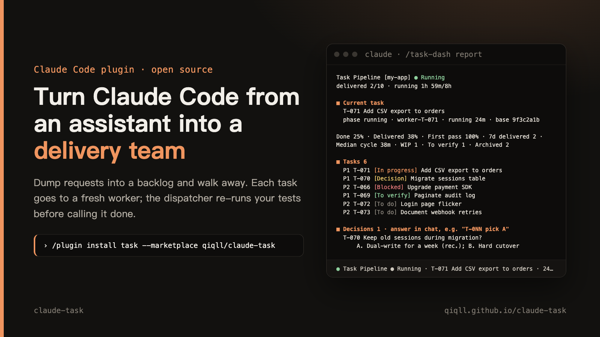
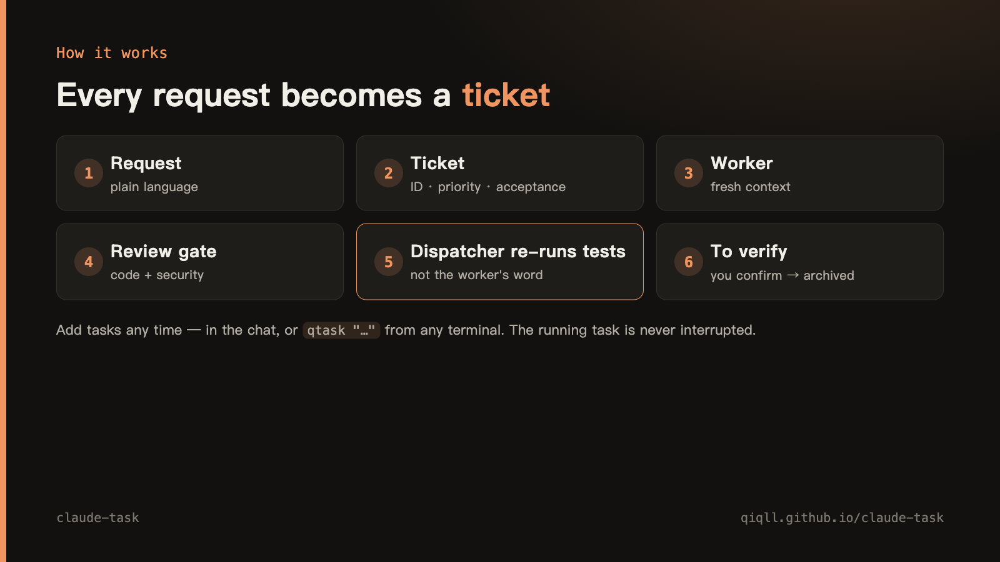
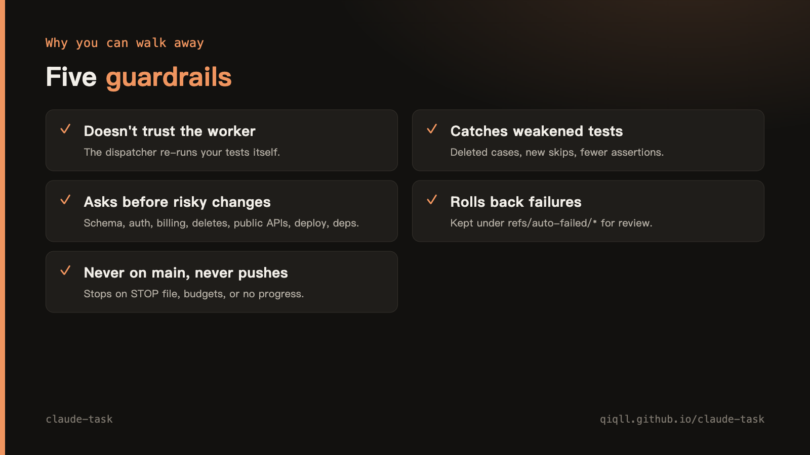
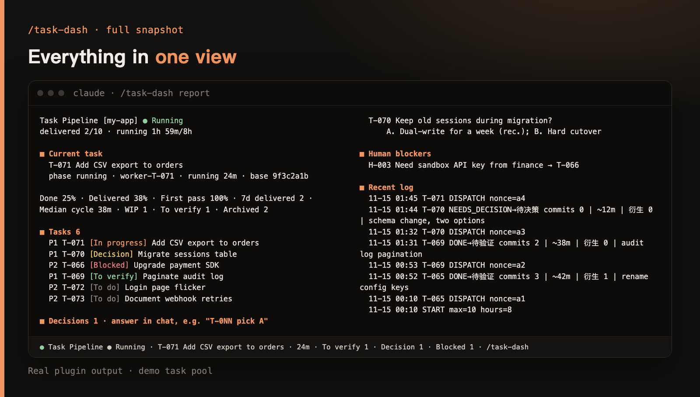
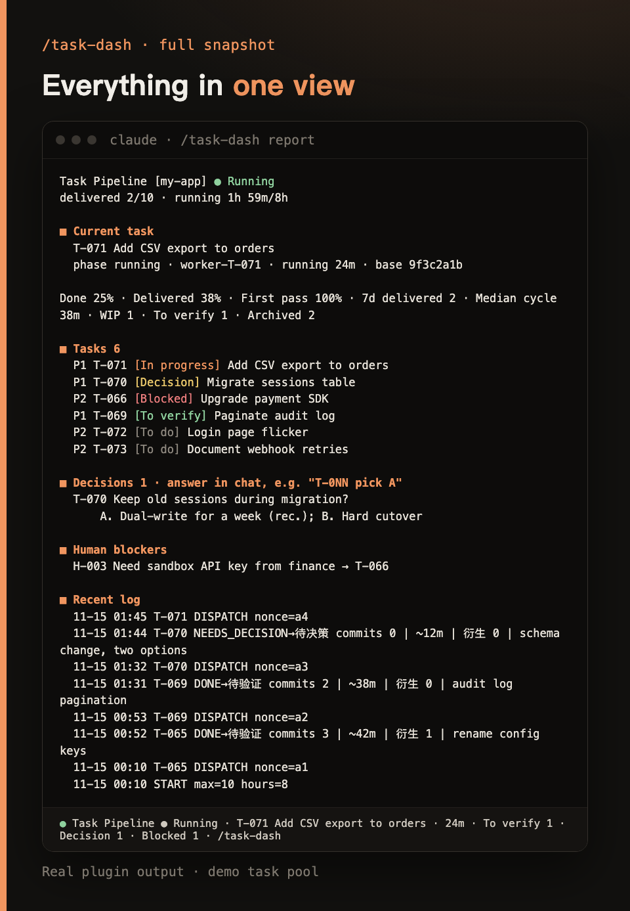

<div align="center">

# claude-task

**Turn Claude Code from an assistant into a delivery team.**

Dump requirements into a backlog and walk away. A dispatcher hands each task to a fresh worker agent, re-runs your tests itself, and only calls it delivered when the machine agrees.

[中文](README.zh-CN.md) · [Website](https://qiqll.github.io/claude-task/) · [Changelog](CHANGELOG.md)

```text
/plugin install task --marketplace qiqll/claude-task
```



<!-- Uncomment after adding docs/assets/demo.gif / 加入 GIF 后取消注释

-->

</div>

## Why

**1. From assistant to team.** Your main session only does three things: listen, dispatch, accept. Implementation goes to a background worker with a fresh context, and review goes to `code-reviewer` / `security-analyst`. You talk to a project lead, not to an assistant too busy coding to listen.

**2. Every request is a ticket, delivered to engineering standards.** A casual request becomes a ticket with an ID, a priority and acceptance criteria. It then goes through implementation, a review gate and a test run by the dispatcher itself, lands in "to verify", and is archived only after you confirm. Every step lives in plain Markdown in your repo, so it's traceable and diffable.

**3. Fully async: fire and forget.** No more staying in sync with the agent, and no more waiting for one thing to finish before asking for the next. Speak up any time in the session, or run `qtask "…"` from any terminal; the current task isn't interrupted. Anything that needs your call goes to a decision queue, and everything else keeps moving with the most conservative choice.

**4. Everything visible at a glance.** A side pane and a status line show what's running, what's done, what's left and what's waiting on you. Toasts fire when a task needs verification or a decision, or gets blocked. Completion rate, first-pass rate and median cycle time are included.

<p align="center"></p>

### Guardrails that let you walk away

- **Doesn't trust the worker's word.** A task counts as done only after the dispatcher re-runs the tests itself.
- **Catches weakened tests.** Deleted cases, new skips and fewer assertions are detected automatically.
- **Asks first on high-risk choices.** Schema/migrations, auth/crypto, billing, data deletion, public APIs, deployment and dependencies: if there's more than one way to do it, it stops and lets you decide.
- **Rolls back failures.** Failed changes are reverted and kept under `refs/auto-failed/*` for review. A task that fails twice is marked blocked.
- **Stays off main and never pushes.** It stops on a `STOP` file, when the task or time budget runs out, or after three rounds without progress.

<p align="center"></p>

> A typical day: before logging off, dump your pending requests and run `/task:loop`. Next morning, review a batch of tasks in "to verify" and answer a few decisions.

## Install

In a Claude Code terminal session, type:

```text
/plugin install task --marketplace qiqll/claude-task
```

Answer `y` to `Add marketplace?`, pick an install scope (user is recommended), then **start a new session**.

If your Claude Code version doesn't accept that form, use the two-step equivalent:

```text
/plugin marketplace add qiqll/claude-task
/plugin install task@claude-task
```

### Get started

In a new session, inside a git repo:

```text
/task:init                          # create the task pool in your project root
/task:add add CSV export to orders  # plain language; several requests at once is fine
! git switch -c tasks && git add .claude .gitignore && git commit -m "chore: task pool"
/task:loop                          # start the loop
```

The third line moves you off `main` and commits the task pool: the loop never runs on `main`/`master` and won't start while the backlog files have uncommitted changes (it never commits your drafts for you). The `!` prefix runs it as a shell command inside Claude Code; running it in your own terminal works too.

### Update

Third-party marketplaces don't auto-update by default. To get a new version:

```text
/plugin marketplace update claude-task
```

Then update the task plugin from the `/plugin` menu (or run `claude plugin update task@claude-task` in a shell) and start a new session. You can also turn on auto-update for `claude-task` under `/plugin` → Marketplaces. **Don't upgrade while a loop is running** (see below).

## Commands

| Command | What it does |
|---|---|
| `/task:init` | Creates the task pool in the project root: `.claude/backlog.md` / `dev-plan.md` / `dev-progress.md` plus the `inbox/` and `auto/` runtime directories |
| `/task:add <request>` | Turns a plain-language request into a ticket (ID, priority, acceptance criteria). Records only; doesn't implement |
| `/task:next [T-NNN]` | Manual single step: implements one task → review gate → commit → "to verify", then stops |
| `/task:loop [max=10] [hours=8]` | Autonomous loop: the main session only dispatches; each task goes to a background worker (`/task:auto`) and is accepted after the tests are re-run |
| `/task:status` | Overview: counts per priority, decisions, blockers, suggested next step |
| `/task-dash [report [all]\|inline\|off\|on]` | Opens the side pane in fullscreen layout; otherwise prints a full snapshot into the conversation. `report all` lists every task; `off`/`on` hides or restores the status line |
| `qtask "…"` | Sends a task or decision to a running loop from your own terminal (separate install, see below) |

States: `To do → In progress → To verify → Done`, with side states `Blocked` / `Decision` / `Rejected`. A task's finished state is "to verify"; it's archived only after you confirm.

`/task:loop` needs a git repo (it records the starting SHA and accepts by commit). `/task:next` commits too, so it also needs one; only `/task:add` and `/task:status` work without git. Don't upgrade the plugin while a loop is running: skill paths include the version number, so an upgrade makes the running loop lose its scripts.

### qtask (optional)

The plugin's `bin/` is only on the PATH of Claude's Bash tool, not your own terminal. To send tasks from your terminal, install a copy:

```sh
curl -fsSL https://raw.githubusercontent.com/qiqll/claude-task/main/plugins/task/bin/qtask -o ~/.local/bin/qtask && chmod +x ~/.local/bin/qtask
qtask -h
```

You can skip it: saying "add a task: …" or "T-0NN pick A" in the dispatcher session does the same thing.

## Pane and status line

**How to open it**

| You want | Do this |
|---|---|
| Live pane docked on the right (tall layout) | Start Claude Code in the fullscreen layout, `CLAUDE_CODE_NO_FLICKER=1 claude`, widen the terminal to at least 110 columns, then run `/task-dash` |
| Full snapshot in the conversation (wide layout) | Run `/task-dash` in the normal layout, or `/task-dash report` anywhere (`report all` lists every task) |
| Interactive pane without fullscreen | `/task-dash inline`; `Esc` closes it |
| Hide or restore the status line | `/task-dash off` / `/task-dash on` |

Wide layout, the full snapshot as it prints into the conversation:

<p align="center"></p>

Tall layout, the same sections stacked as in the side pane:

<p align="center"></p>

<sub>Real plugin output on a demo task pool.</sub>

| Where | Shows | Controls |
|---|---|---|
| Status line under the input | `Task Pipeline ● Running · T-071 title · 12m · To verify 2 · Decision 1 · /task-dash` | `/task-dash off` / `on` |
| Side pane | Loop state, current task, metrics, filterable task list, decisions, human blockers, agents, recent log | `/task-dash` opens it; `ctrl+x tab` focuses, `r` refreshes, `Esc` or `ctrl+x x` closes |
| Toasts | Fire when a task enters to verify / decision / blocked | — |

**Docking on the right needs Claude Code's fullscreen layout** and a terminal at least 110 columns wide:

```sh
CLAUDE_CODE_NO_FLICKER=1 claude      # or export it in ~/.zshrc
```

Otherwise `/task-dash` doesn't push a pane above the input and cover your output. It prints the full snapshot (current task, metrics, task list, decisions, human blockers, agents, recent log) as command output in the conversation, where it scrolls with the chat and uses no model tokens. For an interactive pane anyway, use `/task-dash inline`; `Esc` closes it.

### Interface language

The pane, status line and toasts follow your OS language (Chinese systems get Chinese, everything else English). Order of precedence: the plugin's `language` setting → `LC_ALL` → macOS preferred language → `LC_MESSAGES` → `LANG` → runtime locale. The system language wins over `LANG` because terminals often set `en_US` on a Chinese system; `LC_ALL` is an explicit override, so it comes first.

To pin a language, set the task plugin's `language` to `zh` or `en` in `/config`. Task pool content (titles, notes) is shown as written, not translated.

### Metrics

| Metric | Definition |
|---|---|
| Done | archived / (archived + open tasks) |
| Delivered | (archived + to verify) / same |
| First pass | share of delivered tasks that were never rejected (per task) |
| 7d delivered | `DONE→` events in run.log over the last 7 days |
| Median cycle | median time from `DISPATCH` to the result event in run.log |
| Possibly interrupted | the loop is running or waiting but has had no activity for 3 hours, or is more than 3 hours past its time budget |

## Files

```text
.claude/
├── backlog.md        # P0–P3 tasks, decisions, human blockers, ID rules (your entry point)
├── dev-plan.md       # schedule and in-progress tasks, maintained by the AI
├── dev-progress.md   # archived tasks (### T-NNN)
├── inbox/            # drops from qtask / the dispatcher, merged by the loop
└── auto/             # current / session / run.log / STOP (runtime, gitignored)
```

## Review gate and specialist agents

Before delivering, `/task:next` and the worker send the change to `code-reviewer`, plus `security-analyst` when it touches auth, user input, uploads or crypto. If those agents aren't installed, the skills use a `general-purpose` subagent for the same read-only review. If your project's `CLAUDE.md` defines a stricter gate or test scope, the project wins.

## Migrating from the old version

If you used local `~/.claude/skills/task-*` or `task-dash@claude-task-dash`:

```sh
claude plugin uninstall task-dash          # old pane plugin, if installed
rm -rf ~/.claude/skills/task-{init,add,next,loop,auto,status}
```

Then change `/task-add`, `/task-next`, `/task-loop`, `/task-status` in your project or global `CLAUDE.md` to `/task:add` and so on. The task pool format is unchanged, so an existing `.claude/backlog.md` works as is.

## Development

```sh
claude plugin validate plugins/task
claude plugin test plugins/task
claude --plugin-dir plugins/task     # load from source
```

This repo manages itself with the same task pool; see `.claude/`.

## License

MIT
