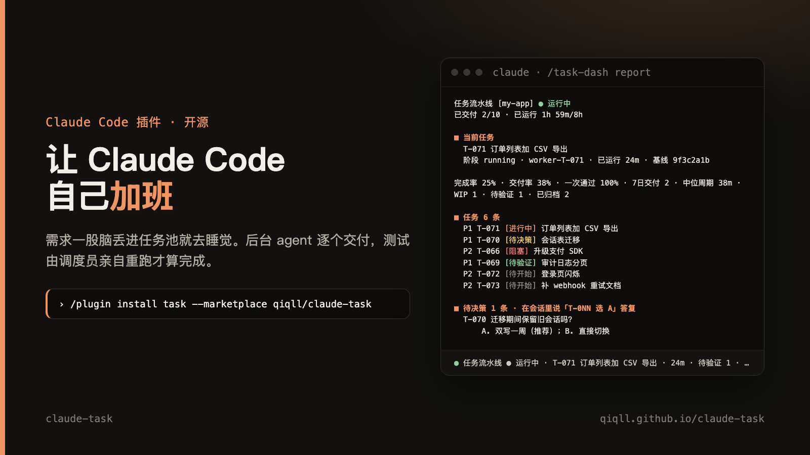
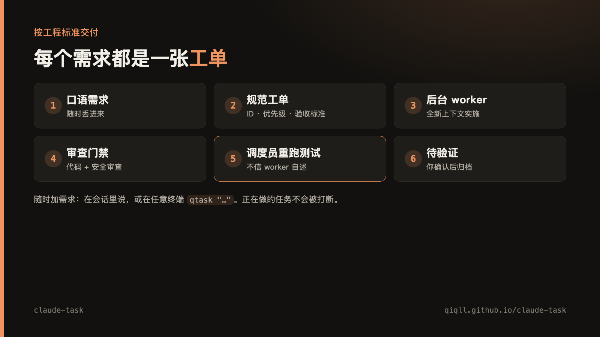
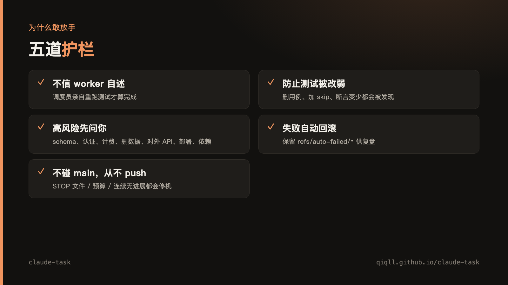
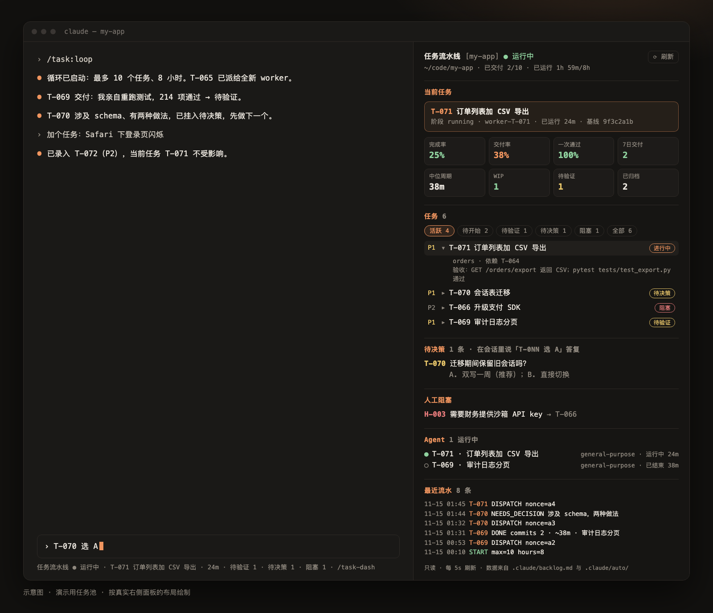
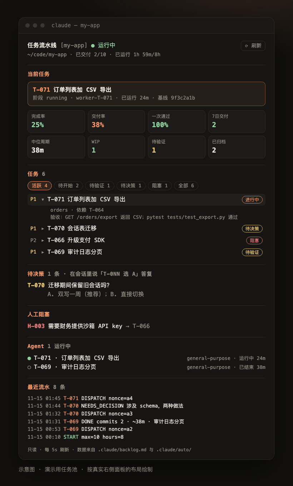
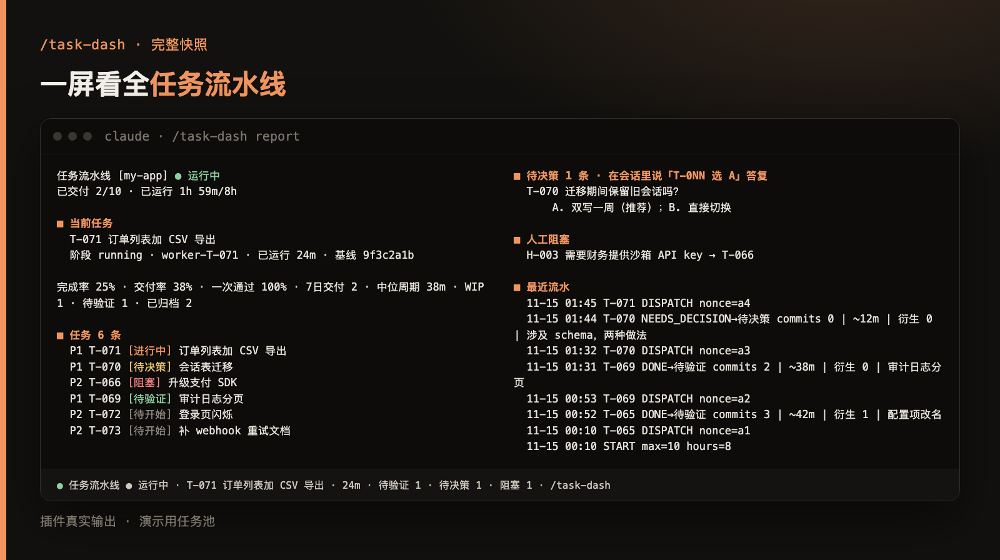

<div align="center">

# claude-task

**把 Claude Code 从助理变成交付团队**

需求一股脑丢进任务池就去忙别的。调度员把每个任务派给全新上下文的 worker，亲自重跑测试，机器验收通过才算交付。

[English](README.md) · [项目主页](https://qiqll.github.io/claude-task/) · [更新日志](CHANGELOG.md)

```text
/plugin install task --marketplace qiqll/claude-task
```



<!-- Uncomment after adding docs/assets/demo.gif / 加入 GIF 后取消注释

-->

</div>

## 为什么用它

**1. 从助理到团队。** 主会话只做三件事：听你说、派活、验收。具体实现交给全新上下文的后台 worker，代码审查交给 `code-reviewer` / `security-analyst`。你面对的是项目经理，而不是一个埋头写代码、顾不上理你的助理。

**2. 需求即任务，按工程标准交付。** 一句口语需求会变成规范任务（ID、优先级、验收标准），然后依次经过实施、审查门禁、调度员亲自重跑测试，进入「待验证」，你确认后才归档。每一步都记录在仓库里的 Markdown 文件中，可追溯、可 diff。

**3. 全异步，想到就丢。** 不用和 agent 同频，也不用等它做完一件才提下一件。你可以随时在会话里插话，或在任意终端用 `qtask "描述"` 投递，当前任务不受打扰。需要你拍板的事项挂进「待决策」，其余按最保守的做法继续推进。

**4. 进度一目了然。** 右侧面板和输入框下方的状态行实时显示正在做什么、做完了什么、还剩什么、等你决定什么。任务进入待验证、待决策或阻塞状态时会弹提醒。完成率、一次通过率和中位周期也一并给出。

<p align="center"></p>

### 敢放手，是因为有护栏

- **不信 worker 自述**：调度员亲自重跑测试，才算完成。
- **防止测试被改弱**：自动检测删用例、加 skip、断言变少等情况。
- **调度员不自己写代码**：循环运行期间，插件钩子拒绝主会话改项目文件（任务池与运行目录除外），活只能交给 worker 做，验收不会变成自己批自己的作业。
- **发现卡住的 worker**：心跳检查 worker 是否还在产出、工作区是否还在变化。停滞的 worker 先被提醒一次，仍无进展就停掉按失败处理，不必等满 3 小时超时。
- **高风险领域先问你**：schema/迁移、认证/加密、计费、删数据、对外 API、部署、依赖，只要有多种做法就停下来让你决定。
- **失败自动回滚**：失败的改动会回滚，并保留在 `refs/auto-failed/*` 供你复盘；同一任务失败两次转为阻塞。
- **不碰 main、从不 push**：遇到 `STOP` 文件、任务数或时长预算用完、连续三轮无进展，任一条件触发就停机。

<p align="center"></p>

> 一个典型用法：下班前把攒下的需求丢进去，运行 `/task:loop`；第二天早上收一批「待验证」，处理几条「待决策」。

## 安装

在 Claude Code 终端会话的输入框里：

```text
/plugin install task --marketplace qiqll/claude-task
```

提示 `Add marketplace?` 时按 `y`，选择安装范围（推荐 user），然后**新开一个会话**生效。

如果你的 Claude Code 版本不接受这种写法，用等价的两步：

```text
/plugin marketplace add qiqll/claude-task
/plugin install task@claude-task
```

### 上手

新开会话，在 git 仓库里：

```text
/task:init                         # 在项目根建任务池
/task:add 给订单列表加 CSV 导出      # 口语录入，可以一次说好几条
! git switch -c tasks && git add .claude .gitignore && git commit -m "chore: task pool"
/task:loop                         # 开始自动循环
```

第三行的作用是离开 `main` 并提交任务池：循环不在 `main`/`master` 上运行，backlog 文件有未提交改动时也不会启动（它从不替你提交草稿）。`!` 前缀表示在 Claude Code 里直接执行 shell 命令，在你自己的终端里执行也一样。

### 更新

第三方市场默认不会自动更新。获取新版本的方法：

```text
/plugin marketplace update claude-task
```

然后在 `/plugin` 菜单里更新 task 插件（或在 shell 里执行 `claude plugin update task@claude-task`），并新开会话。也可以在 `/plugin` → Marketplaces 里给 `claude-task` 打开自动更新。**自动循环运行期间不要升级**（原因见下文）。

## 命令

| 命令 | 作用 |
|---|---|
| `/task:init` | 在项目根建任务池：`.claude/backlog.md` / `dev-plan.md` / `dev-progress.md` + `inbox/` `auto/` 运行目录 |
| `/task:add <需求>` | 口语化需求 → 规范条目（分配 ID、判优先级、写验收标准），只录入不实施 |
| `/task:next [T-NNN]` | 手动单步：挑一个任务实施 → 审查门禁 → 提交 → 转「待验证」后停下 |
| `/task:loop [max=10] [hours=8]` | 自动循环：主会话只调度，每个任务派后台 worker（`/task:auto`），机器重跑测试验收 |
| `/task:status` | 全局视图：各优先级计数、待决策、阻塞、下一步建议 |
| `/task-dash [report [all]\|inline\|off\|on]` | 全屏布局下打开右侧面板，否则把完整快照输出到对话里；`report all` 列出全部任务；`off`/`on` 隐藏或恢复状态行 |
| `qtask "描述"` | 在自己的终端里往运行中的循环投递任务 / 决策（需单独安装，见下） |

状态机：`待开始 → 进行中 → 待验证 → 已完成`，旁路 `阻塞` / `待决策` / `打回`。任务完成态是「待验证」，需求方确认后才归档。

`/task:loop` 需要 git 仓库（记开工 SHA、按提交验收）；`/task:next` 也会提交，同样需要；只有 `/task:add` `/task:status` 不需要 git。自动循环运行期间不要升级本插件（技能路径带版本号，升级会让运行中的循环找不到脚本）。

### qtask（可选）

插件的 `bin/` 只在 Claude 的 Bash 工具里可用，你自己的终端里没有。想在终端投递，装一份到 PATH：

```sh
curl -fsSL https://raw.githubusercontent.com/qiqll/claude-task/main/plugins/task/bin/qtask -o ~/.local/bin/qtask && chmod +x ~/.local/bin/qtask
qtask -h
```

不装也行：在调度会话里直接说「加个任务：…」「T-0NN 选 A」，效果相同。

### 通知

循环在任务进入「待决策」「待验证」「阻塞」或停机时会发一条系统通知（同一事件只发一次，≤100 字，附 `qtask` 回复命令）。派发、空闲这类不需要你处理的时刻不发。默认 macOS 用 `osascript`、Linux 用 `notify-send`；在 `~/.claude/settings.json` 的 `env` 里可以调整：

| 变量 | 作用 |
|------|------|
| `TASK_NOTIFY=off` | 关闭通知 |
| `TASK_NOTIFY_CMD="<命令>"` | 换渠道：命令后面追加 标题、消息 两个参数（如自己的 ntfy / 企业微信脚本） |

## 面板与状态行

**开启方法**

| 想要 | 操作 |
|---|---|
| 右侧停靠的实时面板（竖版） | 用全屏布局启动 `CLAUDE_CODE_NO_FLICKER=1 claude`，终端拉宽到至少 110 列，再运行 `/task-dash` |
| 在对话里输出完整快照（横版） | 普通布局下运行 `/task-dash`；任何布局下都可以用 `/task-dash report`（`report all` 列出全部任务） |
| 不开全屏也要可交互面板 | `/task-dash inline`，`Esc` 关闭 |
| 隐藏 / 恢复状态行 | `/task-dash off` / `/task-dash on` |

全屏布局下停靠在对话右侧：

<p align="center"></p>

面板本身：当前任务、指标卡、可筛选的任务列表（点开一行看验收标准）、待决策、人工阻塞、Agent、最近流水：

<p align="center"></p>

不开全屏时，`/task-dash` 把同样的内容以横版文字快照输出到对话里：

<p align="center"></p>

<sub>数据为演示任务池。面板图是按真实面板布局绘制的示意图，文字快照是插件真实输出。</sub>

| 位置 | 内容 | 操作 |
|---|---|---|
| 输入框下方状态行 | `任务流水线 ● 运行中 · T-071 标题 · 12m · 待验证 2 · 待决策 1 · /task-dash` | `/task-dash off` / `on` |
| 右侧面板 | 循环状态、当前任务、指标、可筛选任务列表、待决策、人工阻塞、Agent、最近流水 | `/task-dash` 打开；`ctrl+x tab` 聚焦，`r` 刷新，`Esc` 或 `ctrl+x x` 关闭 |
| 提醒 | 任务进入待验证 / 待决策 / 阻塞时弹 toast | — |

**右侧停靠需要 Claude Code 的全屏布局**，且终端至少 110 列：

```sh
CLAUDE_CODE_NO_FLICKER=1 claude      # 或在 ~/.zshrc 里 export
```

不满足时 `/task-dash` 不会把面板插到输入框上方挡住输出，而是把完整快照（当前任务、指标、任务列表、待决策、人工阻塞、Agent、最近流水）作为一条命令输出打进对话，随对话滚动、不占模型 token；想要可交互的面板用 `/task-dash inline`，`Esc` 关闭。

### 界面语言

面板、状态行和提醒跟随操作系统语言（中文系统显示中文，其余英文）。判定顺序：插件设置 `language` → `LC_ALL` → macOS 系统首选语言 → `LC_MESSAGES` → `LANG` → 运行时 locale。系统语言优先于 `LANG`，因为终端常设 `en_US` 而系统是中文；`LC_ALL` 是显式覆盖，排在最前。

固定某种语言：`/config` 里把 task 插件的 `language` 设为 `zh` 或 `en`。任务池内容（标题、备注）按原文显示，不翻译。

### 指标口径

| 指标 | 算法 |
|---|---|
| 完成率 | 已归档 /（已归档 + 未关闭任务） |
| 交付率 | （已归档 + 待验证）/ 同上 |
| 一次通过 | 交付过的任务中，从未出现「打回重做」的比例（按任务计） |
| 7 日交付 | 近 7 天 run.log 中 `DONE→` 事件数 |
| 中位周期 | run.log 中 `DISPATCH` 到结果事件的中位时长 |
| 疑似中断 | 循环在跑或等待任务，但 3 小时无任何活动，或已超出时长预算 3 小时以上 |

## 文件

```text
.claude/
├── backlog.md        # P0–P3 任务表、待决策、人工阻塞、ID 规则（需求方入口）
├── dev-plan.md       # AI 维护的排期与进行中任务
├── dev-progress.md   # 已归档任务（### T-NNN）
├── inbox/            # qtask / 调度员投递，循环单点合并
└── auto/             # current / session / run.log / STOP（运行态，gitignore）
```

## 审查门禁与专业 agent

`/task:next` 与 worker 交付前会派 `code-reviewer`（涉及认证 / 用户输入 / 上传 / 加密时加 `security-analyst`）审查改动。环境里没有这些 agent 时，技能改派 `general-purpose` 子 agent 做同样的只读审查。项目 `CLAUDE.md` 有更严的门禁或测试口径时以项目为准。

## 从旧版迁移

用过本地 `~/.claude/skills/task-*` 或 `task-dash@claude-task-dash` 的：

```sh
claude plugin uninstall task-dash          # 旧面板插件（若装过）
rm -rf ~/.claude/skills/task-{init,add,next,loop,auto,status}
```

再把项目 / 全局 `CLAUDE.md` 里的 `/task-add` `/task-next` `/task-loop` `/task-status` 改成 `/task:add` 等。任务池文件格式不变，已有 `.claude/backlog.md` 直接可用。

## 开发

```sh
claude plugin validate plugins/task
claude plugin test plugins/task
claude --plugin-dir plugins/task     # 从源码加载
```

本仓库自身也用这套任务池管理，见 `.claude/`。

## License

MIT
